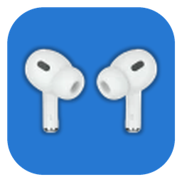

<p align="center"></p>

# Pods

AirPods companion for Windows: battery, ear detection and quick connect for Apple AirPods
and Apple-chip Beats, as a lightweight tray app. No drivers, no admin rights.

> **Early development.** Pods runs in the tray, lists your paired AirPods with their battery
> and connection state, and connects or disconnects them. The features below are in progress.

## Features

- Left / right / case battery with charging state, in the tray and a lid-open popup
- Ear detection: pause when you take an AirPod out, resume when you put it back
- Connect from the tray, a hotkey or by opening the case; audio output switching
- Low-battery notifications

## Building

Requires the .NET 10 SDK on Windows 10 2004 or later (x64). No Visual Studio, Windows SDK,
Developer Mode or certificate is needed.

```
dotnet run --project src/Pods.App
dotnet test
```

Settings and logs live in `%LOCALAPPDATA%\Pods`.

## Licence

MIT, see `LICENSE`. The bundled Inter font is under the SIL Open Font License
(`src/Pods.App/Assets/Fonts/Inter-OFL.txt`).

"AirPods" and "Beats" are trademarks of Apple Inc., used only to describe the hardware
this app works with. This project is not affiliated with or endorsed by Apple.
